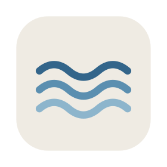
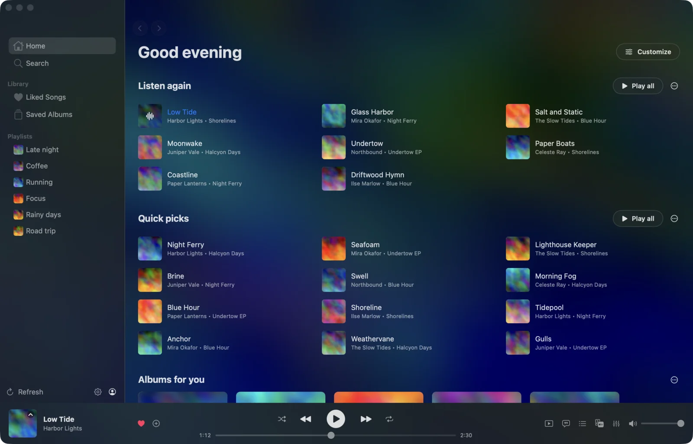
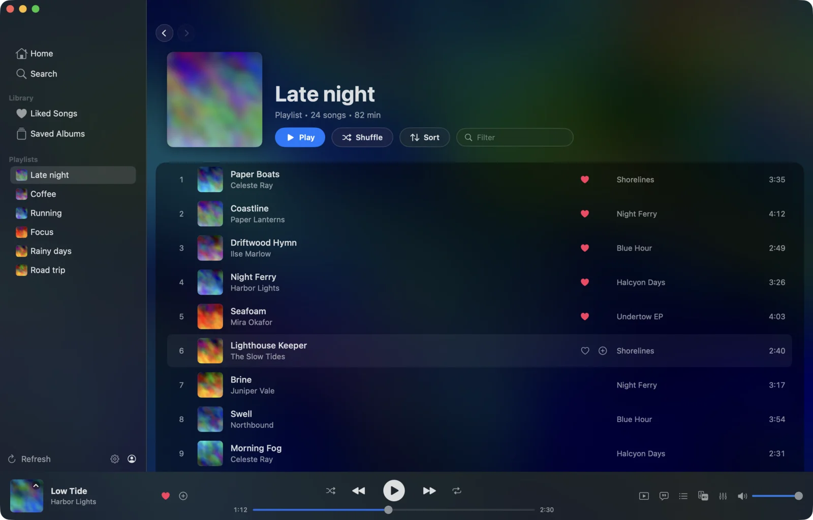
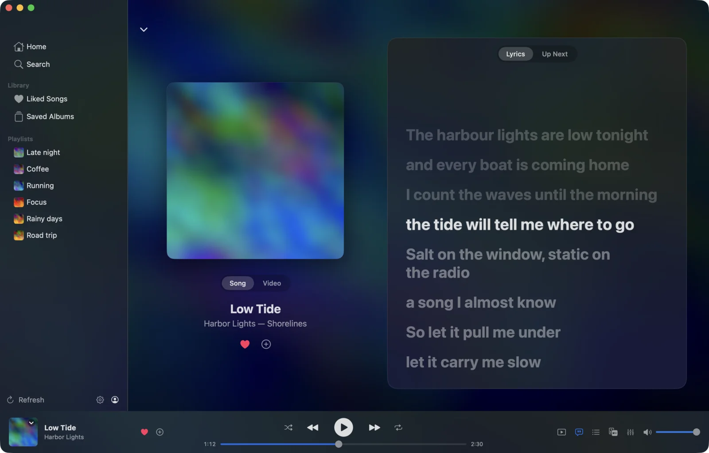
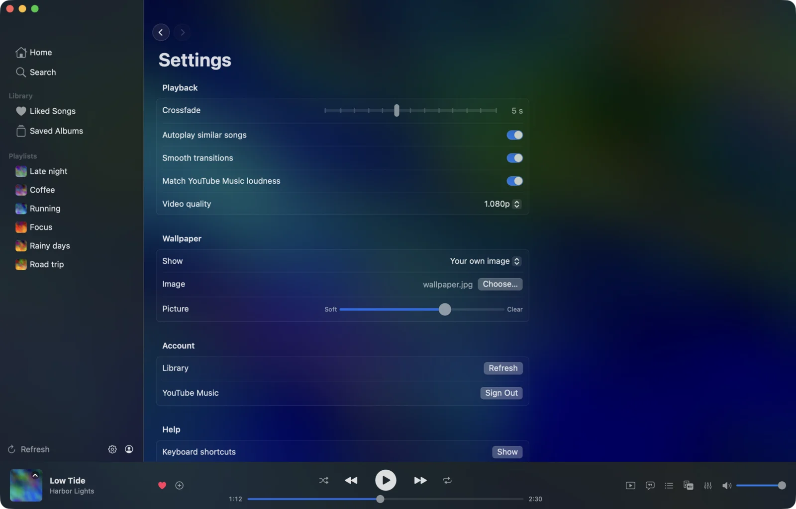

<div align="center">
  
  <h1>Tide</h1>
  <p>A fast, native Mac app for YouTube Music.</p>

  <p>
    
    
    
  </p>

  
</div>

## Features

- Your YouTube Music library: Home, Search, Liked Songs, albums, playlists and artist pages.
- Plays through libmpv: crossfade, loudness matching, smooth fades on pause and skip.
- Switch between the song and its music video without the audio stopping.
- Picks up where you left off, and keeps going with similar songs when the queue runs out.
- Synced lyrics, a command palette (Cmd-K) and keyboard shortcuts for everything (press ?).
- Wallpapers from your own image, the song's cover, or a [Pinstill](https://github.com/bonkedbythonk/pinstill) board, matched to each song's colours.

## Screenshots

<table>
  <tr>
    <td></td>
    <td></td>
  </tr>
</table>



The screenshots use made-up songs and covers (`Scripts/demo.sh`).

## Install

**Mac** (Apple silicon, macOS 15 or later). Paste into Terminal:

```bash
curl -fsSL https://raw.githubusercontent.com/bonkedbythonk/tide/main/Scripts/install.sh | bash
```

Run the same line again to update. It also installs yt-dlp through
[Homebrew](https://brew.sh), which Tide plays through. Sign in with your Google
account on first launch.

<details>
<summary>Install by hand</summary>

Run `brew install yt-dlp deno`, then download `Tide-<version>.zip` from
[Releases](https://github.com/bonkedbythonk/tide/releases), unzip it and drag
Tide to Applications. The app is not notarized, so macOS blocks the first
launch: go to System Settings > Privacy & Security and click **Open Anyway**,
or run `xattr -dr com.apple.quarantine /Applications/Tide.app`.

</details>

Keep yt-dlp current with `brew upgrade yt-dlp`; most playback failures are an
outdated yt-dlp.

<details>
<summary>Build from source</summary>

```bash
git clone https://github.com/bonkedbythonk/tide.git
cd tide
./run.sh
```

`run.sh` builds a release binary, wraps it in `Tide.app` and opens it. Needs the
Xcode command line tools.

</details>

## Disclaimer

Tide is an unofficial client, not made by or affiliated with Google or YouTube. It
plays music from your own YouTube Music account, through your own sign-in, on your
own machine. More in [DISCLAIMER.md](DISCLAIMER.md) and [PRIVACY.md](PRIVACY.md).

Personal project, no support promised. Building and contributing are in
[CONTRIBUTING.md](CONTRIBUTING.md). If you like it:
[ko-fi.com/bonkedbythonk](https://ko-fi.com/bonkedbythonk).

Licensed under [GPLv3](LICENSE).
